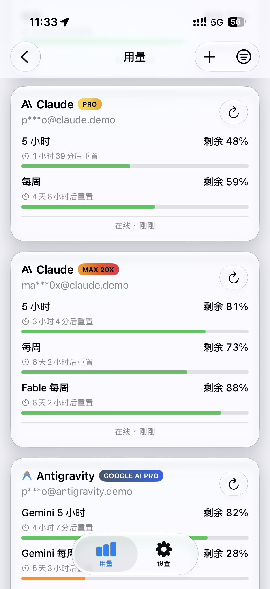
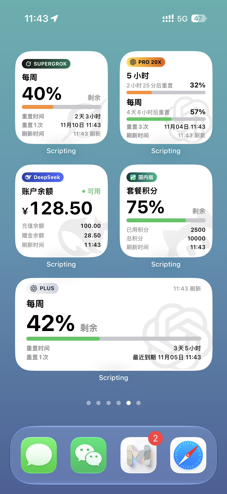
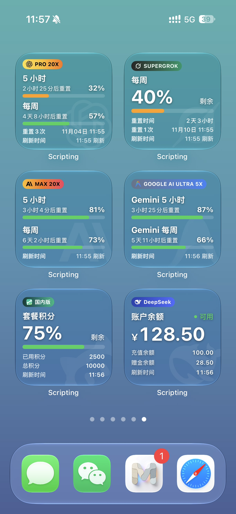
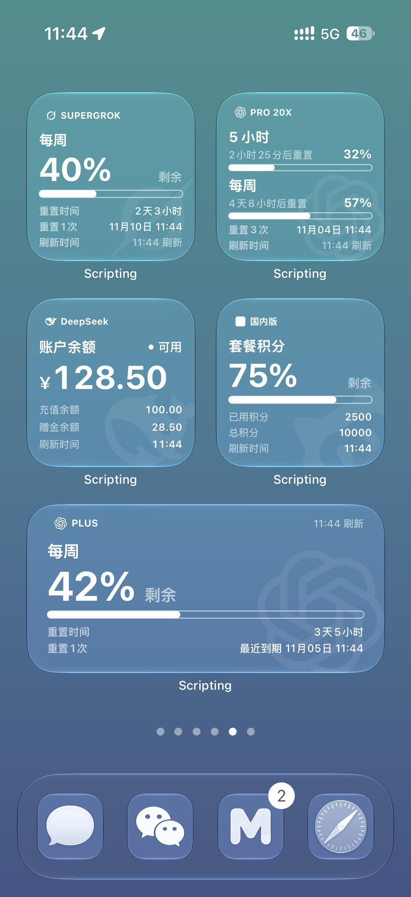

# AI Usage

<table>
  <thead>
    <tr>
      <th align="center" width="25%">应用界面</th>
      <th align="center" width="25%">普通彩色小组件</th>
      <th align="center" width="25%">透明小组件</th>
      <th align="center" width="25%">Clear 简约小组件</th>
    </tr>
  </thead>
  <tbody>
    <tr>
      <td align="center" width="25%"></td>
      <td align="center" width="25%"></td>
      <td align="center" width="25%"></td>
      <td align="center" width="25%"></td>
    </tr>
    <tr>
      <td align="center" width="25%"><sub>用量总览与设置页的浅色 / 深色界面</sub></td>
      <td align="center" width="25%"><sub>彩色风格的单账号组件与多账号看板</sub></td>
      <td align="center" width="25%"><sub>透明桌面下的彩色组件与多账号看板</sub></td>
      <td align="center" width="25%"><sub>透明桌面与Clear风格普通桌面组件</sub></td>
    </tr>
  </tbody>
</table>

面向 [Scripting App](https://scriptingapp.github.io/) 的非官方多平台 AI 用量应用。把 Codex、Grok、Claude、Antigravity、Cursor、Kimi Code、GitHub Copilot、Z.ai、MiniMax、WorkBuddy 与 DeepSeek 的多账号用量、主屏幕小组件和自动刷新集中在一个应用里。

当前版本：`1.9.0`

> 本项目不是 OpenAI、xAI、Anthropic、Google 或 Scripting App 官方产品，与上述平台无隶属或合作关系。

## 功能

- **11 个平台，多账号并行**：Codex、Grok、Claude、Antigravity、Cursor、Kimi Code、GitHub Copilot、Z.ai、MiniMax、WorkBuddy 与 DeepSeek。同一平台可添加多个账号，每个账号独立保存凭据、用量缓存和额度窗口选择。
- **全尺寸主屏幕小组件**：单账号提供 Small / Medium；多账号看板提供 Small / Medium / Large，以及 iOS 竖向整屏 Extra Large（两列六行，最多 12 个账号）。
- **可选的 Scripting 主页入口**：Scripting Pro 用户可将 AI Usage 固定在 Home Tab，直接查看用量并进入设置；不启用不影响独立应用和主屏幕小组件。
- **双重视觉风格**：默认彩色风格保留品牌徽章与绿 / 橙 / 红用量预警；Clear 简约风格在普通桌面使用黑白线框，在透明桌面使用通透白线框。
- **透明桌面适配**：不铺额外底板，使用高对比白字、亮绿进度色和轻微文字阴影；品牌水印与普通组件保持一致。
- **应用内用量总览**：按平台筛选，查看每个账号的额度窗口、重置倒计时和刷新状态；可隐藏指定账号，或对邮箱与手机号做脱敏显示。
- **分步授权引导**：回调地址、设备码与 API Key 都在同一张引导卡内完成，授权页只在点击按钮后打开，失败可原地重试。
- **本地加密与备份**：凭据保存在本机 Keychain，账号、设置和缓存保存在本机 Storage；支持 PBKDF2 + AES-256-GCM 加密备份与跨设备恢复。
- **离线回退与演示模式**：网络异常或接口限流时回退最近一次成功缓存；内置只读演示数据，未连接账号也能预览全部界面和组件。

## 系统要求

- iPhone 或 iPad
- 已安装 Scripting App
- 拥有对应平台账号，并具备该平台的用量查询资格
- 首次授权与刷新用量时需要联网
- 独立应用、主屏幕小组件和快捷指令自动化不需要 Scripting Pro
- 可选的 Scripting Home Tab 常驻入口需要 Scripting Pro

## 安装

### 一键导入

[一键导入 AI Usage](https://www.scripting.fun/import_scripts/?urls=%5B%22https%3A%2F%2Fraw.githubusercontent.com%2FStarYunLee%2FScripting%2Fmain%2FAI-Usage.scripting%22%5D)

点击后会打开 Scripting 官方导入页，确认后唤起 Scripting App 安装。

### 手动安装

1. 下载仓库根目录的 [`AI-Usage.scripting`](../AI-Usage.scripting)。
2. 在 Scripting App 中导入并运行 `AI Usage`。
3. 打开「用量」页，点右上角 `+` 连接平台。
4. 在主屏幕添加 Scripting 小组件，选择 `AI Usage`。

远程导入地址：

```text
https://raw.githubusercontent.com/StarYunLee/Scripting/main/AI-Usage.scripting
```

现有远程更新地址保持不变，已安装的用户可以直接在 Scripting 中更新。

## 快速开始

1. 首次打开可先在「设置 → 账号」开启「演示模式」，用内置数据熟悉界面和小组件。
2. 关闭演示模式，点「用量」页右上角 `+` 选择平台，按引导完成授权。
3. 在主屏幕添加 Scripting 小组件：单账号组件在账号详情中复制参数，多账号看板使用固定参数 `dashboard`。
4. 在「设置」中调整组件风格、刷新间隔、背景主题和账号显示。
5. 可选：Scripting Pro 用户可在 Scripting 设置中开启 `Show Home Tab` 并选择 `AI Usage`，把用量页固定到 Scripting 主页。

## 连接账号

所有平台都使用同一套分步引导：选择平台 → 按页面提示点击按钮打开授权页 → 回到应用粘贴回调地址、一次性授权码或 API Key，或等待应用自动检查结果。

| 平台 | 授权方式 | 需要准备 |
|---|---|---|
| Codex | ChatGPT OAuth 回调 | 授权后地址栏中的完整回调地址 |
| Grok | xAI OAuth 回调 | 完整回调地址，或页面显示的一次性授权码 |
| Claude | Anthropic OAuth | 授权结果页的 `code#state` 授权码 |
| Antigravity | Google OAuth 回调 | 授权后地址栏中的完整回调地址 |
| Cursor | 内嵌授权页登录 | 关闭授权页后自动检查，无需粘贴 |
| Kimi Code | 设备授权 | 关闭授权页后自动检查，无需粘贴 |
| GitHub Copilot | GitHub 设备授权 | 应用显示的设备码；关闭授权页后自动检查，最多等待 10 秒 |
| Z.ai | API Key（国内站 / 国际站） | 对应控制台创建的 API Key |
| MiniMax | Subscription Key（国内站 / 国际站） | 对应站点创建的 Subscription Key |
| WorkBuddy | 浏览器账户授权（国内站 / 国际站） | 关闭授权页后自动检查；使用外部浏览器时返回后点「检查授权结果」 |
| DeepSeek | API Key | DeepSeek 开放平台创建的 API Key |

补充说明：

- 回调型授权出现打不开的 `localhost` 页面是正常现象，复制地址栏中的完整地址即可。
- 回调型 OAuth 临时状态有效期为 10 分钟，设备授权与控制台密钥验证通常为 15 分钟；Authorization Code 通常只能交换一次。
- 授权失败或超时后，按引导页提示继续或重新开始，不需要删除账号。
- Antigravity 的套餐标签按上游身份信息显示，只有在明确提供倍率时才细分为 Ultra 5x / 20x；查询失败时保留最后已知标签，不根据额度大小推断套餐。
- WorkBuddy 只接入浏览器账户授权，不提供 desktop 本地登录或 API Key 方式；组件采用固定布局，不提供额度窗口选择。
- DeepSeek 只读取账户余额，不发起模型生成请求；币种按接口返回自动显示，不提供手动设置。

## 用量页

「用量」页集中展示所有已连接账号：

- 顶部可按平台筛选。
- 账号卡显示平台、套餐或站点标签、账号标识（可隐藏中段）、额度窗口、重置倒计时与刷新状态。
- 点开账号卡进入详情，可以重新授权、选择要显示的额度窗口、预览组件、复制组件参数或删除账号；DeepSeek 还可以修改本地账户名称。
- 右上角 `+` 添加账号，刷新按钮可手动更新全部用量。

「设置 → 账号」中提供：

- **演示模式**：使用只读演示数据预览界面和组件，不写入真实账号。
- **隐藏账号标识**：对用量卡中的邮箱与手机号中段做脱敏显示。
- **用量页显示的账号**：逐账号控制是否出现在用量页；不影响授权、刷新和主屏幕小组件。

账号详情中分为两组窗口开关：「用量总览」只影响用量页；「桌面小组件」只影响单账号组件，Small 与 Medium 共用这份选择。多账号看板的窗口选择在「设置 → 多账号小组件 → 账号配置」中单独保存。

## 主屏幕小组件

### 单账号组件

单账号组件提供 Small 与 Medium 两种尺寸：

- Small 最多显示 2 个额度窗口，Medium 最多显示 4 个。
- 主数值和进度条长度都表示剩余额度，不提供「已用 / 剩余」切换。
- 颜色按剩余额度判断风险：剩余高于 40% 为绿色，不高于 40% 为橙色，不高于 15% 为红色。
- 重置时间使用相对表述，刷新时间显示最近一次成功更新的时间。

绑定步骤：

1. 打开目标账号详情页，在「预览与参数」中点击「小组件参数」复制。
2. 长按主屏幕，添加 Scripting 小组件并选择 `AI Usage`。
3. 长按小组件选择「编辑小组件」，把参数粘贴到「参数」。

参数格式为 `provider:profileId`。只有一个已授权账号时，参数留空也会自动使用该账号；同一平台有多个账号时，请为每个组件填写对应参数。

### 多账号看板

多账号看板把多个账号放进同一个组件：

- 固定参数为 `dashboard`；演示模式下为 `dashboard:demo`。
- Small 最多 2 个账号，Medium 最多 4 个，Large 最多 8 个。
- iOS 竖向整屏 Extra Large（`systemExtraLargePortrait`）采用两列六行，最多 12 个账号；横向 Extra Large 仍回退为 Large 布局。
- 每个账号最多选择 2 个额度窗口，窗口标题会简写为 `5h`、`7d` 等形式；完整名称仍在账号详情中显示。
- 账号标识默认显示邮箱前缀、手机号后四位，长名称保留首尾；同平台标识重复时补充域名线索或稳定后缀。
- 看板底部显示最近刷新时间和刷新按钮，账号超出当前尺寸时显示隐藏数量。

配置入口：「设置 → 多账号小组件」可以开关账号标识、进入「账号配置」逐账号选择是否展示及额度窗口，或复制看板参数。

多账号看板读取本地缓存快照，设置修改后即时生效；需要更新数据时，在 App 内下拉刷新或点击看板底部的刷新按钮。

### 组件风格

「设置 → 小组件 → 小组件风格」对全部主屏幕组件生效：

- **默认（彩色）**：保留平台彩色徽章，进度条使用绿 / 橙 / 红风险色。
- **Clear（简约）**：使用无底色徽标与镂空进度条；普通桌面为黑白反差，透明桌面为通透白线框。

透明组件不铺额外底板，依赖高对比文字、亮绿用量色和轻微文字阴影。受 iOS 静态壁纸切片机制限制，在强光、高反差或复杂壁纸下可能出现局部对比度差异。

### 刷新间隔

「设置 → 小组件 → 刷新间隔」同时控制应用启动自动刷新与小组件自动联网的最短间隔：

- 手动
- 5 分钟（默认）
- 15 分钟
- 30 分钟
- 60 分钟

选择「手动」后，仅在下拉刷新、点击刷新按钮或运行快捷指令时联网。每个账号的窗口选择和布局独立保存，刷新间隔对所有账号生效。iOS WidgetKit 可能根据系统调度延后组件重建，所选时间不是严格定时器。

## 自动化刷新

小组件日常依赖系统时间线调度。如需更稳定地更新桌面用量，可通过快捷指令创建定时自动化：

1. 打开 iOS 快捷指令 → 自动化。
2. 添加动作：Scripting → 运行意图脚本。
3. 脚本选择 `AI Usage`。
4. 关闭「运行前询问」。

该动作会拉取全部已授权账号的最新用量，并请求刷新主屏幕小组件。也可以使用系统 App Intent 按平台或全量刷新。

## 数据来源

用量数据来自各平台官方客户端当前使用的认证和内部用量接口，不是面向第三方承诺长期稳定的公开 API。

| 平台 | 数据来源 |
|---|---|
| Codex | OpenAI OAuth 与 ChatGPT 内部用量接口 |
| Grok | xAI OAuth 与 Grok Build / CLI 订阅额度接口 |
| Claude | Anthropic OAuth 与 Claude Code 用量接口 |
| Antigravity | Google OAuth 与 Antigravity / Code Assist 用量接口 |
| Cursor | Cursor 账户授权与用量接口 |
| Kimi Code | Kimi Code 设备授权与额度接口 |
| GitHub Copilot | GitHub 设备授权与 Copilot 用量接口 |
| Z.ai | Z.ai / 智谱 API Key 与用量接口 |
| MiniMax | MiniMax Subscription Key 与 Token Plan 用量接口 |
| WorkBuddy | WorkBuddy 国内版 / 国际版浏览器账户授权与积分接口 |
| DeepSeek | DeepSeek 开放平台 API Key 与官方账户余额接口 |

服务端更新后，路径、字段或访问策略可能变化。

## 隐私与安全

- OAuth Token 仅保存在当前设备的 Scripting Keychain。
- 账号注册表、小组件设置和用量缓存仅保存在本机 Scripting Storage。
- 项目不通过作者服务器转发登录或用量数据。
- 源代码和正常导出的安装包不包含你的账号、邮箱、Token 或用量缓存。
- 刷新记录保留请求状态、本机账号标签和必要错误摘要，不输出 Token、授权码、Cookie 或完整接口响应。
- 删除账号时会同时删除该账号的本机凭证、用量缓存和独立布局设置。
- 不要分享 OAuth 回调 URL、一次性授权码、Token、Keychain 导出或完整 App 容器备份。
- Antigravity 使用 Google 已公开的官方桌面客户端 OAuth 凭据完成登录，不是作者个人云项目密钥；你的账号 Token 仍只保存在本机。

## 已知限制

- 各平台内部用量接口可能随时变化。
- OAuth 成功不代表所有账号都具有对应用量查询资格。
- Antigravity 套餐身份可能缺失或不含倍率；最后已知套餐不代表当前订阅仍有效，不能据此判断是否取消订阅。
- 账号实际拥有的额度窗口由服务端决定，缺失窗口显示 `—`。
- WidgetKit 不保证严格按照所选分钟数刷新。
- 透明小组件依赖 Scripting 静态壁纸切片机制，在极高频高光杂色壁纸下可能存在局部对比度差异。
- 单账号小组件未专门适配 Large；未知或不支持的尺寸按现有回退渲染。
- Small 使用所选窗口顺序中的前 2 项。
- WorkBuddy 组件采用固定布局，不提供额度窗口选择；签到状态与积分数据取决于接口返回。
- DeepSeek 只展示余额，不显示额度上限、使用百分比或重置时间。
- 演示模式只用于预览界面，不会写入真实账号或发起授权请求。

## 项目结构

```text
AI Usage/
├── assets/                   平台 Logo、水印与动态展示图
├── components/               共享 UI 与用量卡片
├── pages/                    用量、设置、账号详情、日志页
├── providers/                Codex / Grok / Claude / Antigravity / Cursor / Kimi / Copilot / Z.ai / MiniMax / WorkBuddy / DeepSeek 适配
├── services/                 刷新编排、配色、设置、演示与存储
├── widget/                   小组件分发、Loader 与平台布局
├── app_intents.tsx           系统 App Intent
├── home_screen_default_ui.tsx Scripting 主页 Tab 常驻入口
├── index.tsx                 应用独立运行入口
├── intent.tsx                快捷指令刷新入口
├── widget.tsx                小组件入口
├── changelog.ts              版本更新日志
├── script.json               Scripting 项目元数据
├── LICENSE                   MIT License
└── README.md
```

## 反馈

问题反馈请前往 [GitHub Issues](https://github.com/StarYunLee/Scripting/issues)，标题中用方括号注明项目名称，例如 `[AI Usage]`。

## 版权与免责声明

项目采用 [MIT License](LICENSE)。

本项目仅用于查看本人账号的用量信息。请自行评估内部接口变更、账号策略和第三方脚本带来的风险，并遵守 OpenAI、xAI、Anthropic、Google 与 Scripting App 的服务条款。项目不保证接口永久可用，也不对用量延迟、解析差异、限流或服务端策略变化承担责任。
