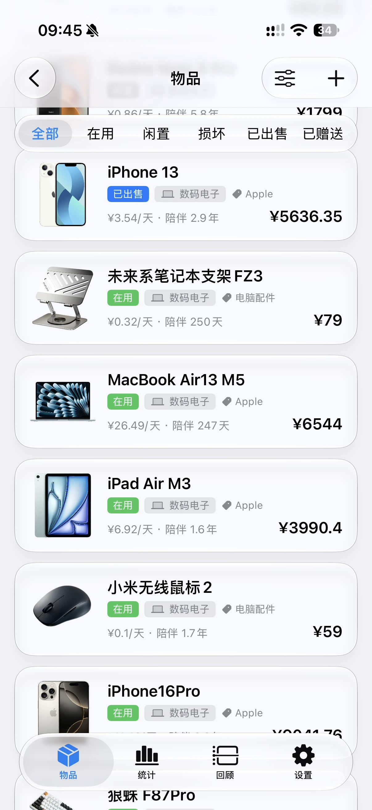
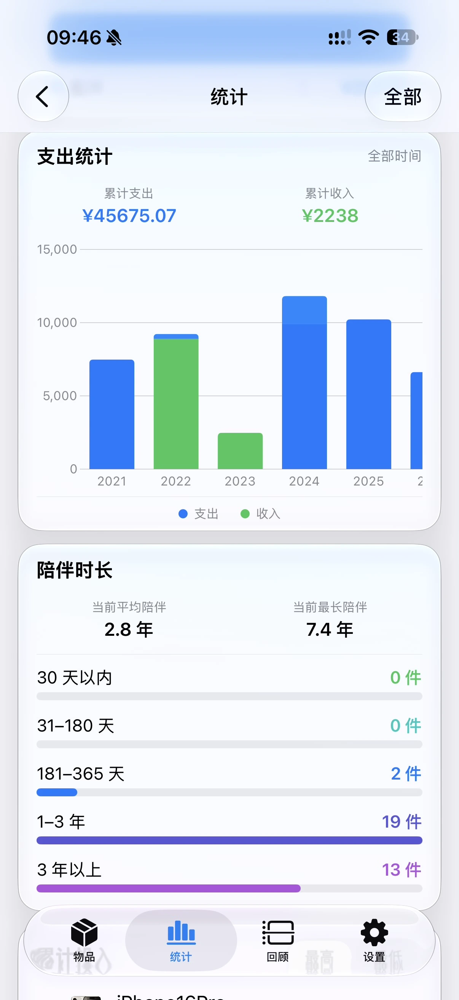
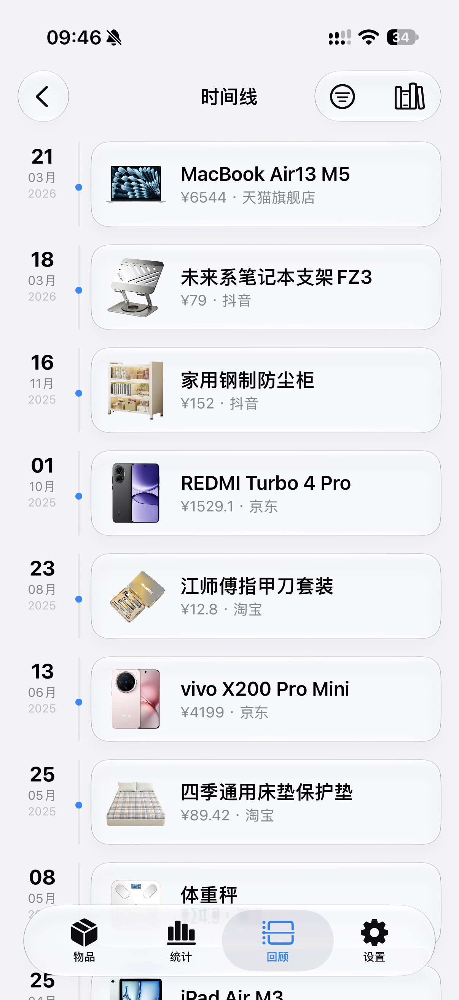

# Itemory

<table>
  <tr><th>物品</th><th>统计</th><th>回顾</th></tr>
  <tr>
    <td width="33%"></td>
    <td width="33%"></td>
    <td width="33%"></td>
  </tr>
</table>

Itemory 是一款运行在 Scripting App 中的个人物品管理工具。买下一件物品时记下价格，使用期间补上维修和配件支出，转手时记下回收金额。打开物品详情，就能看到它陪伴了你多久，以及平均每天花了多少钱。

当前版本：`1.0.0`

## 功能

- **整理物品**。用照片、分类和标签整理物品，记录购买渠道、保修日期、估值与备注。在清单或网格中搜索、筛选，也可以按购入价或日均成本排序。
- **记录持有成本**。为同一件物品添加支出与收入。出售、赠送、丢弃或遗失时，可以登记结束持有；误操作后可撤销。
- **查看年度统计**。按年份查看收支趋势、分类投入和物品排行。想回看某件物品的经历，可以从时间线或置物架进入详情。
- **从订单截图录入**。配置 AI 服务后，可以从截图提取名称、金额和购入日期，或生成透明背景的物品图。核对并保存后，物品才会进入档案。

## 系统要求与安装

在 iPhone 或 iPad 上安装 [Scripting App](https://scriptingapp.github.io/)。Itemory 使用 SQLite 存储本机数据，**需要已开通 Scripting Pro**。

[一键导入 Itemory](https://www.scripting.fun/import_scripts/?urls=%5B%22https%3A%2F%2Fraw.githubusercontent.com%2FStarYunLee%2FScripting%2Fmain%2FItemory.scripting%22%5D) · [下载安装包](../Itemory.scripting)

使用仓库源码时，将整个 `Itemory/` 目录放入 Scripting 的脚本目录，在脚本列表中打开 **Itemory**。点击「物品」右上角的 `+` 即可手动添加第一件物品。日常记录、统计和备份均可离线使用。

## 怎样计算一件物品的成本

净支出等于购入金额加上后续支出，再减去相关收入和退出时的回收金额。日均成本按净支出除以持有天数计算，购入当天计为第 1 天，结束持有后算到退出当天。

例如，一台显示器购入花费 1,800 元，维修花费 200 元，最后以 800 元出售，净支出就是 1,200 元。如果持有了 600 天，日均成本为 2 元。

金额以人民币记录。购入价暂时查不到时可以留空，免费获得时填写 `0`，档案会区分这两种情况。购入价或出售回收金额未知时，详情页会提示成本仅按已知金额计算。

## AI 识图与物品图

在「设置 → AI 服务 → AI 识图录入（试验性）」填写兼容 OpenAI 接口的服务地址与 API Key，选择支持图片输入的信息解析模型。如需测试生成透明物品图，再选择图像模型。效果测试可独立使用；要在新增物品时使用这些能力，请开启「解析物品信息」，再按需开启「生成透明物品图」。

可以先在「效果测试」里选一张订单截图，选择「仅信息」「仅物品图」或「信息与物品图」。点「开始测试」后才会调用模型。组合模式中，先返回的结果可以先看；收起面板后，可从设置页查看同一次测试的进度和结果。接口响应和耗时在「测试详情」中查看。

截图会发往你配置的服务，可能产生费用。建议在选图前遮住姓名、电话、地址和订单号。「停止等待」会结束本机等待，上游服务仍可能继续处理或计费。API Key 保存在本机钥匙串中。

## 备份与数据交换

在「设置 → 数据管理 → 数据与备份」选择适合的操作。

| 用途 | 文件 | 恢复或导入后的效果 |
| --- | --- | --- |
| 换设备、重装或保留完整快照 | `.itemory` 单文件 SQLite，包含物品记录、流水、正式封面和应用偏好 | **替换当前数据**。应用先校验备份并显示物品、流水和封面数量，确认后重新打开完成恢复。 |
| 将其他工具的数据整理为交换包后批量追加 | `.zip` 数据交换包，包含 `data.json` 和 `images/` | **追加物品**，按名称复用分类和标签。相同内容的数据包有重复导入检查。 |

完整备份上限为 320 MiB，其中封面合计最多 256 MiB。数据交换包上限为 128 MiB。需要把已有清单转成交换格式时，可在导入页获取 AI 转换指令。

物品和正式封面保存在本机 SQLite 数据库中。导出的两种文件均为明文，可能包含订单信息、图片和备注，请存放在受信任的位置。更换设备后，如需继续使用 AI 功能，请重新配置密钥。

## 许可

Itemory 是独立开发的 Scripting 项目，采用 [MIT License](./LICENSE)。
